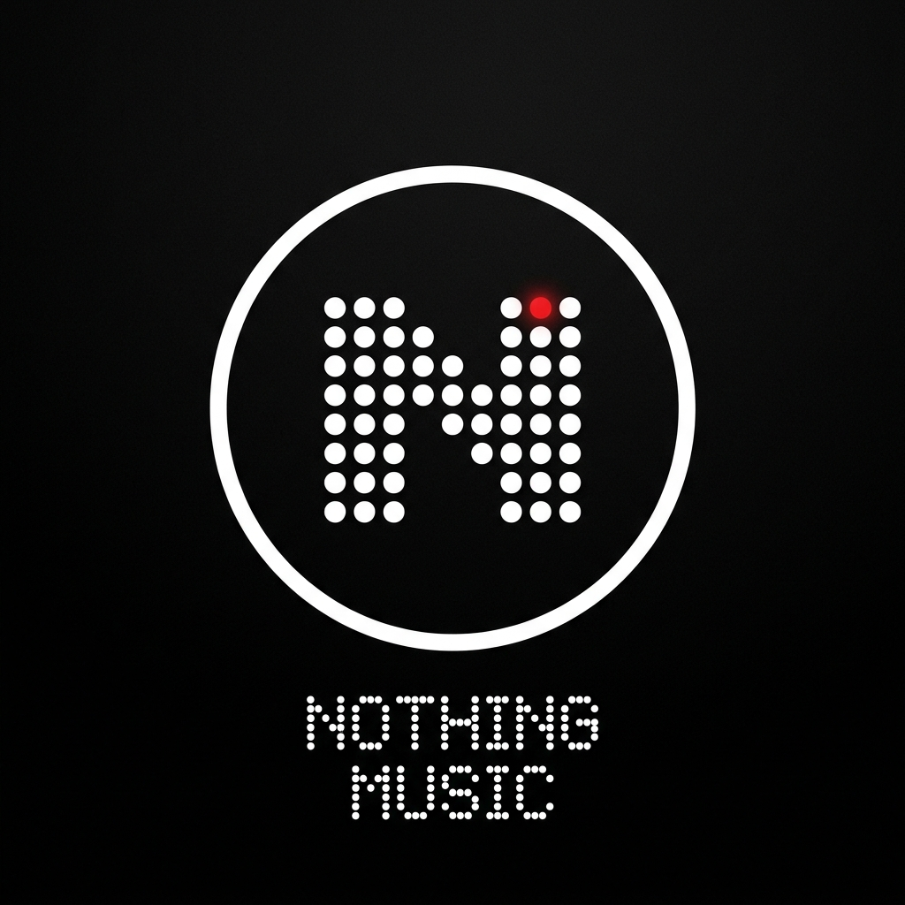

 
 

# ( NOTHING ) MUSIC

### Nothing OS Aesthetic YouTube Music Client

 

 

[**Download APK**](#download) · [**Nothing OS Design**](#design) · [**Features**](#features) · [**Disclaimer**](#disclaimer)

---

<h1>Nothing OS Aesthetic</h1>

Nothing Music is a ground-up aesthetic redesign of BitChord, rebuilt to integrate into the **Nothing Phone & Nothing OS ecosystem**:

* **Pure OLED Black (`#000000`)**: Complete dark-first design tuned for AMOLED efficiency.
* **Signature Nothing Red (`#D71921`)**: Accent indicators, pulse marks, glyph controls, and scrubber fills.
* **Mechanical Typography**: Geometric typography with Space Grotesk / Space Mono tabular figures and tracked uppercase headers.
* **Sharp Industrial Surfaces**: Flat matte surfaces with hairline borders (`#ffffff18`), removing frosted glass blurs in favor of raw, honest, industrial design.
* **Cross-Platform**: Tailored for both the native Android APK (Jetpack Compose) and the Web Player.

---

<h1>Download APK</h1>

### 📱 Android Phone:
1. Go to the **[Actions Tab](https://github.com/Jassy8/Nothing-Music/actions)**.
2. Click on the latest **Android Release APK** run.
3. Under **Artifacts** at the bottom of the page, click **`nothing-music-apk`** to download.
4. Extract the `.zip` and install the `.apk` on your device.

*(Requires Android 8.0+ / API 26+)*

---

<h1>Features</h1>

<table>
  <tr>
    <td width="50%" valign="top">

#### Playback & Audio
- **Full YouTube Music Library** — stream and search across tracks, albums, artists and community playlists.
- **Hi-Res Lossless Audio** — FLAC/ALAC playback with intelligent fallback.
- **Gapless Playback & Crossfade** — seamless transitions between songs.
- **Automix DJ Transitions** — beat-matched tempo-stretching between tracks.
- **Offline Downloads** — save songs and albums with complete embedded metadata.
- **Local Audio Support** — play local device audio files alongside streaming.

#### Connectivity & Accounts
- **Google Account Sign-In** — access personalized recommendations, playlists, and history.
- **Spotify Integration** — import and stream your Spotify Liked Songs and playlists.
- **Discord Rich Presence** — real-time listening status and album art on Discord.
- **Scrobbling** — support for Last.fm and ListenBrainz.

    </td>
    <td width="50%" valign="top">

#### Visuals & Experience
- **Nothing OS UI** — monochromatic contrast, Nothing Red accents, and industrial borders.
- **Word-Synced Animated Lyrics** — syllable-level highlighting and smooth auto-scroll.
- **Motion Artwork Canvas** — animated album canvases for supported albums.
- **Hardware Equalizer Integration** — native system equalizer integration.
- **Stats for Nerds** — detailed audio stream codec, sample rate, and bit depth.

#### Controls & Customization
- **Network-Aware Audio Quality** — separate quality ceilings for Wi-Fi and Mobile Data.
- **Sleep Timer** — custom timers and "stop after current track".
- **Playback Speed Control** — 0.5× to 2.0× speed adjustment and skip-silence.

    </td>
  </tr>
</table>

---

<h1>Disclaimer & Legal Notice</h1>

Nothing Music is an independent, community-driven third-party audio player. It is not affiliated with, endorsed by, or connected to YouTube, Google LLC, or Nothing Technology Limited.

- **No Media Hosting:** Nothing Music does not host, upload, or store music files. It connects to public-facing and user-authenticated APIs.
- **License:** Licensed under the [GNU General Public License v3.0 (GPLv3)](LICENSE).

